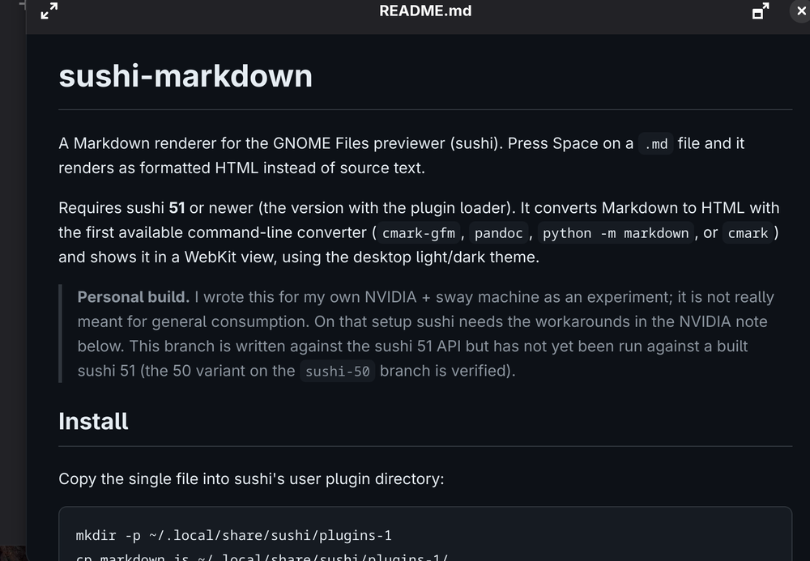

# sushi-markdown

A Markdown renderer for the GNOME Files previewer (sushi). Press Space on a
`.md` file and it renders as formatted HTML instead of source text.



This is a fork of [SippieCup/sushi-markdown](https://github.com/SippieCup/sushi-markdown)
with fixes that make the `sushi-51` branch actually work against released
sushi 51 (the upstream branch was written against the pre-release API and had
never been run against a built sushi 51 — see [Fixes](#fixes)).

It converts Markdown to HTML with the first available command-line converter
(`cmark-gfm`, `pandoc`, `python -m markdown`, or `cmark`) and shows it in a
WebKit view, using the desktop light/dark theme.

## Install

### Arch Linux — package from Releases (CI-built)

Every push builds a package with GitHub Actions; tags attach it to a release.

```sh
# one-shot install of the latest release
url=$(curl -s https://api.github.com/repos/grigio/sushi-markdown/releases/latest \
  | grep -o 'https://[^" ]*any\.pkg\.tar\.zst' | head -1)
curl -LO "$url" && sudo pacman -U --noconfirm "$(basename "$url")"
```

Or add it as a rolling pacman repo (the release doubles as a repo):

```ini
# /etc/pacman.conf
[sushi-markdown]
Server = https://github.com/grigio/sushi-markdown/releases/latest/download
```

```sh
sudo pacman -Syu sushi-markdown
```

Then install a converter (see below).

### Arch Linux — build from source

```sh
git clone -b sushi-51 https://github.com/grigio/sushi-markdown.git
cd sushi-markdown
makepkg -si
```

### Any distro — manual install

Copy the single file into sushi's user plugin directory:

```sh
mkdir -p ~/.local/share/sushi/plugins-1
cp markdown.js ~/.local/share/sushi/plugins-1/
```

No restart or setting is needed. The next preview of a Markdown file uses it.

## Converters

Install one of these. GFM-capable ones first (tables, strikethrough):

| Converter | Tables/strikethrough | Notes |
|---|---|---|
| `cmark-gfm` | yes | AUR |
| `pandoc` | yes | |
| `python-markdown` | yes | `sudo pacman -S python-markdown` |
| `cmark` | no | plain Markdown only |

## Requirements

- sushi **51** or newer (`extra/sushi` on Arch — the version with the plugin loader).
  For sushi 50 use the upstream `sushi-50` branch.
- `webkitgtk-6.0` (usually already present).
- A Markdown converter (see above).

Handled types: `text/markdown`, `text/x-markdown`.

## Fixes

Compared to upstream's `sushi-51` branch, this fork applies two small fixes so
the plugin loads with released sushi 51.2:

1. **`mimeTypes` → `contentTypes`** — sushi 51.2's `rendererSelector.js` only
   picks up plugins exporting `contentTypes` (or `supportsContentType`); the
   old export name was silently ignored.
2. **`isReady()` → `markReady()`** — the Renderer interface method was renamed
   before the 51 release; the old call threw a `TypeError` as soon as a
   preview opened.

Both were verified against a real sushi 51.2 build on GNOME 51 (the preview in
the screenshot above was rendered by this plugin).

## NVIDIA / wlroots note

*(from upstream, unchanged)* On an NVIDIA + sway setup sushi will not render a
WebKit view out of the box: it crashes on native Wayland (`Error 71`), and
WebKit's DMABUF renderer fails on the proprietary driver (blank preview).
Scope both fixes to sushi alone with a user-level D-Bus override, so nothing
else on the system is affected:

`~/.local/share/dbus-1/services/org.gnome.NautilusPreviewer.service`

```ini
[D-BUS Service]
Name=org.gnome.NautilusPreviewer
Exec=/usr/bin/env GDK_BACKEND=x11 WEBKIT_DISABLE_DMABUF_RENDERER=1 /usr/lib/org.gnome.NautilusPreviewer
```

Float it in a tiling WM (sway/i3), matched on the XWayland class:

```
for_window [class="Org.gnome.NautilusPreviewer"] floating enable, move position center
```

None of this is needed on Mutter/GNOME or non-NVIDIA systems.

## License

GPL-2.0-or-later, matching sushi. See [LICENSE](LICENSE).
